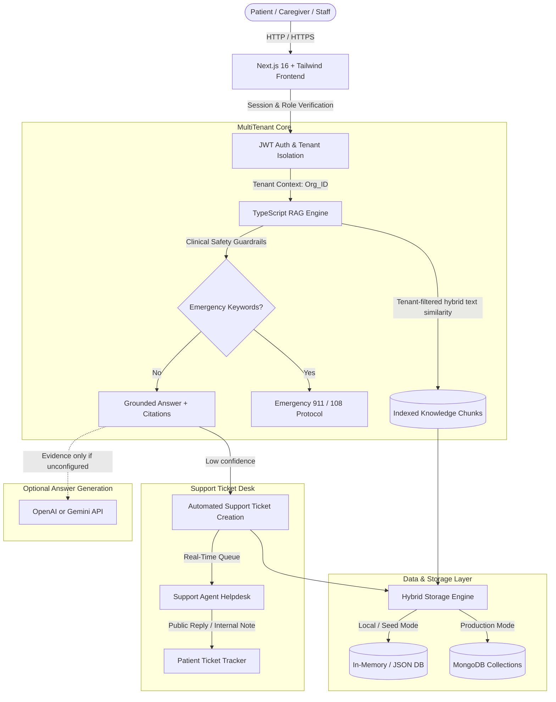

# AI-Powered Multi-Tenant Healthcare Support Agent
**MCA Final-Year Capstone Project** • Next.js 16 + React 19 + TypeScript + Tailwind CSS + MongoDB

---

## 🏥 1. Project Overview & Scope

The **AI-Powered Multi-Tenant Healthcare Support Agent** is an enterprise-grade artificial intelligence support platform engineered for healthcare organizations including multi-specialty hospitals, specialty outpatient clinics, diagnostic laboratories, and telehealth networks.

### Core Objectives
1. **Multi-Tenancy & Data Isolation:** Each healthcare organization operates in complete isolation with its own staff, approved policy documents, vector embeddings, patient conversations, and support tickets.
2. **Grounded Retrieval-Augmented Generation (RAG):** The AI chatbot retrieves organization-scoped document chunks and includes source citations. Retrieval uses hybrid text similarity; answer generation can use OpenAI or Gemini when configured, otherwise the app returns evidence-only answers.
3. **Medical Safety & Emergency Triage:** The system enforces clinical disclaimers. If a patient inquires about acute emergency symptoms (such as chest pain, breathlessness, loss of consciousness, stroke signs, or severe bleeding), the platform activates emergency protocols advising immediate dispatch to **911 / 108 / 112**.
4. **Human Escalation Workflow:** When queries fall below confidence thresholds or require human intervention, the system automatically creates a support ticket routed to hospital support agents with full conversation context.

---

## 🏗️ 2. Architectural Diagram



---

## 👥 3. User Roles and Initial Setup

The application does not ship with public demo credentials or seeded users. Create the first platform administrator through the one-time `/setup` flow using `BOOTSTRAP_ADMIN_EMAIL` and `BOOTSTRAP_ADMIN_PASSWORD`. The administrator can then provision organizations. Patients register against an active organization; staff accounts should be created by an authorized administrator.

| Role | Capabilities |
| :--- | :--- |
| **Super Admin** | Provision organizations, view platform analytics, inspect tenant boundaries, and manage platform-wide settings. |
| **Hospital Admin** | Manage their tenant’s knowledge documents, users, tickets, and analytics. |
| **Support Agent** | Work tickets, reply to customers, and update ticket status and priority. |
| **Patient / Customer** | Use AI support, review their own conversation history, and create or track support tickets. |

---

## 🚀 5. Quickstart & Installation Instructions

### Prerequisites
- **Node.js**: v20.16+ (or v22.3+)
- **npm** or **yarn** or **pnpm**
- **Python**: 3.10+ (optional, for FastAPI microservice)

### Step 1: Install Dependencies
```bash
# In the project root directory:
npm install
```

### Step 2: Configure Environment Variables
Copy `.env.example` to `.env.local`:
```bash
# Windows PowerShell:
Copy-Item .env.example .env.local

# Linux / macOS:
cp .env.example .env.local
```

### Step 3: Run the Next.js Development Server
```bash
npm run dev
```
Open your browser and navigate to **`http://localhost:3000`**.

For production, configure `MONGODB_URI` and a strong `JWT_SECRET`. Without MongoDB, the development-only in-memory store starts empty and resets when the server restarts. It is not suitable for production or persistent demonstrations.

### First administrator and tenant setup

1. Set `BOOTSTRAP_ADMIN_EMAIL` and a unique `BOOTSTRAP_ADMIN_PASSWORD` of at least 12 characters in `.env.local`.
2. Start the server and open `http://localhost:3000/setup`.
3. Sign in with the created administrator and provision one or more organizations from the platform dashboard.
4. Configure `OPENAI_API_KEY` or `GEMINI_API_KEY` if you want LLM answer generation. Without a provider key, the app returns retrieved evidence directly.

Password reset email requires `RESEND_API_KEY`, `EMAIL_FROM`, and `APP_URL`. Never commit `.env.local` or share provider credentials.

### AI and retrieval behavior

- Uploaded PDF, DOCX, and UTF-8 TXT documents are text-extracted, chunked, and stored with their tenant identifier in MongoDB.
- Retrieval currently uses tenant-filtered hybrid text similarity; it is **not** a ChromaDB/Qdrant vector index and does not generate dense embeddings.
- OpenAI/Gemini answer generation is optional and receives the retrieved document excerpts. Review the provider’s data-processing terms before sending sensitive content.
- Low-confidence or empty-knowledge responses automatically create a support ticket.
- The optional `fastapi_rag_service` is a separate example service and is not called by the Next.js chat API.

---

## 🐍 6. Optional Python Service

`fastapi_rag_service/` contains an optional prototype. It is not connected to the application’s chat or document-upload flow.

```bash
cd fastapi_rag_service
python -m venv venv

# Windows:
.\venv\Scripts\activate
# Linux / macOS:
source venv/bin/activate

pip install -r requirements.txt
python main.py
```
The FastAPI service runs on `http://localhost:8000`. You can test its interactive Swagger documentation at `http://localhost:8000/docs`.

---

## 📡 7. API Reference

| Endpoint | Method | Role | Description |
| :--- | :--- | :--- | :--- |
| `/api/auth/login` | `POST` | Public | Authenticates credentials and sets an HttpOnly session cookie. |
| `/api/auth/register` | `POST` | Public | Registers a customer account for an active organization. |
| `/api/auth/me` | `GET` | Authenticated | Returns current authenticated session profile. |
| `/api/auth/bootstrap` | `POST` | Configured one-time setup | Creates the initial platform administrator. |
| `/api/chat` | `POST` | Patient | Executes tenant-scoped retrieval, safety checks, answer generation, and low-confidence ticket escalation. |
| `/api/chat/conversations` | `GET`, `POST` | All | Lists or creates conversation sessions. |
| `/api/knowledge` | `GET`, `POST`, `DELETE` | Admin | Manages tenant-scoped documents, including PDF/DOCX/TXT text extraction and chunking. |
| `/api/tickets` | `GET`, `POST` | All | Lists support tickets with tenant isolation or creates new tickets. |
| `/api/tickets/[id]` | `GET`, `PATCH`, `POST` | Staff / Patient | Updates ticket status, assigns agents, and posts replies. |
| `/api/organizations` | `GET`, `POST` | Super Admin | Lists or provisions healthcare tenant organizations. |
| `/api/analytics` | `GET` | Admin | Returns operational KPIs, resolution rates, and audit logs. |
| `/api/organizations/audit` | `POST` | Super Admin | Tests retrieval boundaries across two organizations and records an audit event. |

---

## 🎓 8. MCA Viva & Technical Evaluation Q&A

### Q1: What makes this architecture multi-tenant?
**Answer:** In multi-tenant architecture, a single software application serves multiple distinct client organizations (tenants). Here, every organization record, knowledge document, chunk vector, chat message, and support ticket is strictly partitioned by `organizationId`. The server derives the tenant context from the verified user session token, preventing any cross-tenant data leakage.

### Q2: How does Retrieval-Augmented Generation (RAG) reduce unsupported answers?
**Answer:** The user's query is matched against chunks retrieved only from the authenticated tenant's documents. When configured, an LLM is instructed to answer only from those excerpts. The no-provider mode returns the evidence directly. Low-confidence or missing evidence produces a fallback and a support ticket. This reduces unsupported answers but cannot guarantee that an LLM never makes a mistake.

### Q3: Why is emergency keyword detection implemented before RAG retrieval?
**Answer:** Administrative chatbots must never delay urgent medical care. High-risk keywords (e.g. chest pain, shortness of breath, slurred speech) immediately bypass routine policy retrieval to trigger an emergency redirect with emergency numbers (**911 / 108 / 112**) and legal non-clinical disclaimers.

### Q4: How is tenant isolation verified?
**Answer:** The Super Admin dashboard provides a **Tenant Boundary & Data Isolation Auditor**. It compares document citations returned for the same query across two organizations. This is a functional regression check, not a proof of security; API authorization and tenant-scoped database queries remain the primary controls.
